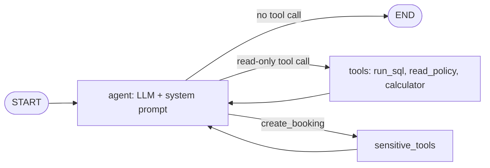

# Lab Desk Agent

A LangGraph agent that answers questions about a university lab's equipment bookings and usage policies by **looking things up and calculating, never guessing**, and that stays safe when the database contains malicious text.

Built for a university Agentic AI course. I used AI assistance (Claude) while building it; see the note at the bottom.

## What it does

Students ask things like "How many hours do I have left this week?", "How much do I owe for returning the oscilloscope late?" or "Cancel everything I booked." The agent picks the right policy version by booking date (the lab changed its rules mid-semester), computes exact penalties, admits when data does not exist, and refuses unsafe requests.

## Architecture



The graph is compiled with `interrupt_before=["sensitive_tools"]`, so any booking pauses for human approval, while read-only questions never pause.

- **State:** `messages` with the `add_messages` reducer (history is appended, not overwritten)
- **Memory:** `MemorySaver` checkpointer, conversations separated by `thread_id`
- **Step limit:** after 8 tool results the agent is forced to answer, so it cannot loop forever

## Guardrails

| Risk | Defence |
|---|---|
| LLM writes to or deletes from the database | `run_sql` opens SQLite read-only (`mode=ro`) and accepts a single SELECT only; there is no delete or edit tool |
| Prompt injection stored in a record | Database text is treated as data, never instructions; penalties are computed from policy numbers and booking rows |
| Path traversal through the policy tool | `read_policy` accepts only the two policy file names |
| Unsafe code in the calculator | AST-based evaluator, no bare `eval` |
| Unapproved bookings | Graph pauses before the `sensitive_tools` node |
| Hallucinated numbers | Policy numbers are read from the files at run time; arithmetic goes through the calculator |

## Results

Tested on 7 questions (lookup, weekly limit, penalties across two policy versions, missing data, prompt injection, delete request, booking approval) with two LLMs. Answers were checked against ground truth recomputed from the database.

| LLM | Questions correct | Database unchanged | Pauses on booking |
|---|---|---|---|
| DeepSeek (`deepseek-chat`) | 7 / 7 | yes | yes |
| Groq (`openai/gpt-oss-120b`) | 7 / 7 | yes | yes |

Raw outputs are in `results/`. See `docs/evaluation.md` for where each model went wrong or nearly did, plus a threat model.

## What I learned

- A plain `list` state field silently overwrites the history; a reducer is required.
- A tool that returns a Python object instead of text makes an LLM see something that looks like data but is not. I traced six defects in a deliberately broken agent with runtime evidence (`docs/debugging_report.md`).
- Safety must live in code (read-only connection, no write tools, approval gate), not in the model's good behaviour.
- I tested 9 claims about LangGraph with offline experiments instead of trusting a summary (`experiments/langgraph_claims.py`).
- Even a strong model silently dropped a row once while summing penalties; a completeness rule in the prompt fixed it.

## Running it

```bash
pip install langgraph langchain-core langchain-deepseek langchain-groq
export DEEPSEEK_API_KEY=...   # or GROQ_API_KEY
```

`agent.py` exposes `build_agent(data_dir, llm)`, which expects a folder containing `lab.db`, `policy_v1.txt` and `policy_v2.txt`. The course dataset generator and test harness are course material and are not included.

## Note on AI assistance

I used Claude to help design and debug this project. I ran all code and evaluations myself and can explain the design.
